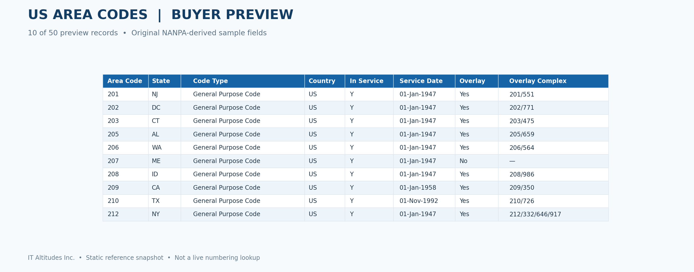
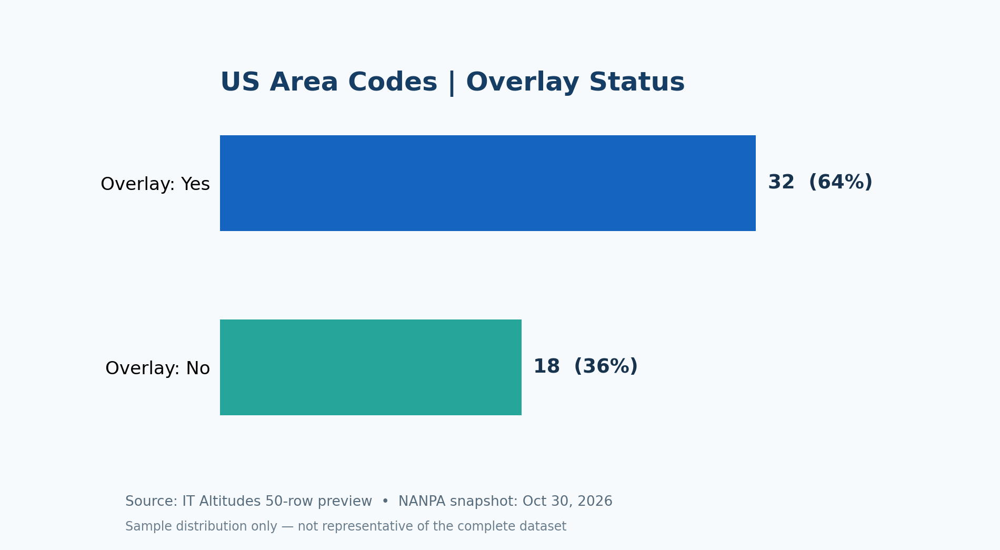

# U.S. Area Codes & Geographic Reference Dataset — Preview

**IT Altitudes Inc. | U.S. Telecommunications & Geographic Reference Data | October 30, 2026**

**Free Preview Formats: Excel (.xlsx) | CSV (.csv) | JSON (.json)**

## Dataset Overview

Explore a structured reference dataset covering U.S. telephone area codes, geographic relationships, area code status, and related telecommunications information.

Prepared by **IT Altitudes Inc.**, this dataset is designed to support telecom research, market analysis, geographic data enrichment, business planning, and analytical workflows.

The free buyer preview allows users to examine the data structure, sample records, and supporting documentation before purchasing the complete dataset.

## Purchase the Complete Dataset

Need broader U.S. area code coverage and detailed documentation?

Upgrade from the free 50-row preview to the complete IT Altitudes U.S. Area Codes & Geographic Reference Dataset.

The full buyer kit provides structured reference information, additional lookup views, data documentation, and supporting materials for telecommunications research, geographic analysis, and business intelligence.

**[Purchase the Full Dataset on Gumroad](https://italtitudes.gumroad.com/l/wehmwd)**

Explore the free preview, review the certificates, and choose the complete dataset when you're ready for broader coverage.

| Dataset Details | Information |
|---|---|
| Product | U.S. Area Codes & Geographic Reference Dataset |
| Source | North American Numbering Plan Administration (NANPA) |
| Source file | `npa_report.csv` |
| Data snapshot | October 30, 2026 |
| Full source records | 800 |
| U.S.-labeled records | 402 |
| Free preview | 50 representative records |
| Preview formats | Excel (.xlsx), CSV (.csv), JSON (.json) |
| Provider | IT Altitudes Inc. |

## Download the Free Buyer Preview

Explore the same 50-record preview in your preferred format.

| Format | Recommended For | Download |
|---|---|---|
| Excel (.xlsx) | Spreadsheet analysis and reviewing documentation | [Download Excel Preview](US_Area_Codes_GitHub_50_Row_Buyer_Preview.xlsx) |
| CSV (.csv) | Python, R, SQL, and analytical workflows | [View CSV Preview](https://github.com/ITAltitudesDataset/us-area-codes-dataset-preview) |
| JSON (.json) | Software development, application testing, and data integration | [Download JSON Preview](US_Area_Codes_50_Row_Preview.json) |

### Why Multiple Formats?

- **Excel:** Convenient for spreadsheet-based analysis and reviewing supporting worksheets.
- **CSV:** Suitable for importing data into Python, R, SQL, and business intelligence tools.
- **JSON:** Useful for structured data processing, software applications, and integration testing.

**Preview Details**

- 50 selected records
- 7 columns in the CSV and JSON preview
- Matching source records across CSV and JSON
- Static reference snapshot dated October 30, 2026

The preview allows buyers to evaluate:

- Area code records and geographic information
- Geographic and non-geographic classifications
- Area code status and reference fields
- Data structure and field definitions
- Documentation and usage limitations

The preview represents only a limited selection of records from the complete dataset.

## View Certificates

Explore the supporting documents prepared by IT Altitudes to understand the dataset's reported validation checks, intended benefits, and practical applications.

### 1. Content Validation Certificate

**[View Content Validation Certificate](certificates/Content%20Validation%20Certificate%20Infographic%281%29.png)**

This certificate summarizes:

- Data structure and formatting checks
- Source field review
- Geographic classification and mapping checks
- Data consistency and completeness review
- Documentation and usability assessment

### 2. Buyer Benefits & Value Certificate

**[View Buyer Benefits & Value Certificate](certificates/Buyer%20Benefits%20%26%20Value%20Certificate%281%29.png)**

This certificate explains:

- Why the structured dataset is useful
- Potential time savings
- Intended buyer audiences
- Business and research applications
- Value of the documentation and prepared reference information

*Both certificates are provider-prepared informational materials. They do not represent official NANPA certification or independent accreditation.*

## Machine Learning Demonstration

Explore our reproducible K-Means clustering demonstration using the US Area Codes 50-row preview.

The model groups area codes using service year and overlay-complex size, illustrating how machine learning can identify patterns in telecommunications reference data.

**[View US Area Codes ML Demonstration](ml_demo/README_ML_DEMO.md)**

*Educational demonstration only. Clusters do not predict future area-code assignments or identify callers' locations.*

## Why Choose the Complete Dataset?

The complete IT Altitudes buyer kit provides broader reference coverage and additional documentation for U.S. area code research.

**Key benefits:**

- **Time-saving:** Access organized area code information without manually assembling individual records.
- **Geographic research:** Explore relationships between area codes, states, and regions.
- **Data enrichment:** Use area code reference fields in compatible analytical workflows.
- **Ready for analysis:** Work with structured data that can be processed using Excel, Python, or R.
- **Clear documentation:** Understand field meanings, methodology, sources, and limitations.

The underlying official source data is publicly available. The value of the buyer kit comes from its organization, preparation, documentation, and usability.

## Who Can Benefit?

| Audience | Potential Use |
|---|---|
| Telecommunications professionals | Area code reference and telecom research |
| Market researchers | Regional and geographic analysis |
| Business analysts | Market planning and data enrichment |
| Data analysts and scientists | Data preparation and analytical workflows |
| GIS professionals | Geographic reference and mapping |
| Software developers | Area code lookup applications |
| Educational researchers | Telecommunications research |

## Business Use Cases

The **U.S. Area Codes & Geographic Reference Dataset** supports practical applications across telecommunications research, business intelligence, geographic data analysis, software development, and market research.

The following use cases illustrate how organizations can work with structured U.S. telephone area code information for research and non-production analytical purposes.

### 1. Telecommunications Market Research

**Ideal for:** Telecommunications analysts, network researchers, and telecom consulting firms.

**Business Applications:**

- Examine U.S. area code assignments and geographic classifications.
- Study relationships between area codes and available state or regional references.
- Research geographic and non-geographic numbering categories.
- Prepare descriptive summaries of numbering information.
- Support telecommunications industry research.

**Potential Buyer Value:** Reduce manual organization of area code reference information and simplify exploratory telecommunications research.

### 2. Geographic Data Enrichment & Reference Mapping

**Ideal for:** Data analysts, GIS researchers, and business intelligence teams.

**Business Applications:**

- Enrich compatible datasets with area code reference attributes.
- Associate area codes with available geographic classifications.
- Develop preliminary geographic lookup tables.
- Prepare regional summaries based on area code references.
- Support research involving U.S. numbering geography.

**Potential Buyer Value:** Provide structured geographic reference fields for analytical enrichment and mapping workflows.

**Important:** Telephone area codes do not reliably identify a subscriber's current physical location. Geographic mappings may be approximate or cover multiple service areas.

### 3. Regional Market Intelligence & Business Planning

**Ideal for:** Market researchers, business consultants, and strategic planning teams.

**Business Applications:**

- Examine geographic numbering references across U.S. states and regions.
- Support preliminary regional market research.
- Organize reference information for business intelligence reporting.
- Develop exploratory geographic comparison tables.
- Support regional planning research using available area code classifications.

**Potential Buyer Value:** Simplify the preparation of area code reference information for market intelligence and business research.

**Important:** Area code assignments alone do not establish population size, customer demand, market share, or commercial opportunity.

### 4. Area Code Lookup & Application Prototyping

**Ideal for:** Software developers, application designers, and database engineers.

**Business Applications:**

- Build prototype area code lookup applications.
- Develop search and filtering interfaces for reference records.
- Test area code classification and geographic lookup functionality.
- Create non-production data integration demonstrations.
- Evaluate structured JSON and CSV processing workflows.

**Potential Buyer Value:** Provide organized reference data for developing and testing area code lookup functionality.

**Important:** The dataset is not a live telephone-number validation, routing, or subscriber-location service.

### 5. Business Intelligence & Geographic Dashboards

**Ideal for:** Business intelligence analysts, dashboard developers, and data visualization professionals.

**Business Applications:**

- Create area code distribution charts.
- Visualize available state and regional reference information.
- Compare geographic and non-geographic classifications.
- Develop dashboards using Excel, Power BI, Tableau, or Python.
- Prepare descriptive reports from available numbering reference fields.

**Potential Buyer Value:** Reduce repetitive data preparation when building geographic and telecommunications research dashboards.

### 6. Data Engineering & ETL Pipeline Testing

**Ideal for:** Data engineers, database administrators, and analytics developers.

**Business Applications:**

- Import structured area code records into SQL databases.
- Develop Excel, CSV, and JSON ingestion workflows.
- Practice data normalization and schema validation.
- Test duplicate detection and missing-value handling.
- Build non-production ETL and analytical pipelines.
- Evaluate reference-data integration processes.

**Potential Buyer Value:** Provide structured telecommunications reference data for analytical workflow development and testing.

### 7. Academic Research & Telecommunications Education

**Ideal for:** Universities, students, educators, and research institutions.

**Business Applications:**

- Study the North American Numbering Plan and U.S. area code references.
- Explore geographic and non-geographic numbering classifications.
- Develop educational data analysis exercises.
- Practice filtering, grouping, and visualizing structured reference data.
- Support academic research into telecommunications numbering systems.

**Potential Buyer Value:** Provide organized reference information for educational research and practical analytical exercises.

## Dataset Preview & Visual Insights

### Sample Data Preview

### Area Code Overlay Distribution — 50-Row Sample

Explore the free 50-row preview to review area code identifiers, state assignments, service dates, overlay status, and numbering plan information.

**Preview highlights:**
- 50 area code records
- 9 dataset fields
- 32 overlay-enabled records
- 18 records without an overlay flag

**Note:** These statistics describe the 50-row sample only, not the complete dataset.

**[Get the Complete US Area Codes Dataset](https://italtitudes.gumroad.com/l/wehmwd)**

For source information and limitations, see our [Data Quality Report](DATA_QUALITY_REPORT.md).

### Why Consider the Complete Buyer Kit?

The free 50-row preview allows users to evaluate the dataset structure and selected area code records.

The complete buyer kit provides:

- **Broader Area Code Coverage:** Expanded reference information beyond the free preview.
- **Additional Lookup Views:** Supporting geographic and numbering reference information.
- **Data Documentation:** Field definitions, methodology, and usage guidance.
- **Quality Information:** Provider-reported validation and preparation details.
- **Analytical Compatibility:** Structured data suitable for Excel, Python, R, SQL, and business intelligence workflows.
- **Research Support:** Organized reference information for telecommunications and geographic analysis.

**[Explore the Complete U.S. Area Codes Dataset on Gumroad](https://italtitudes.gumroad.com/l/wehmwd)**

*Business use cases are illustrative and depend on the fields, coverage, and completeness of the purchased dataset. This is a static reference resource, not a live numbering database or telephone subscriber-location service.*

---

## Free Preview vs. Complete Buyer Kit

| Feature | Free Preview | Complete Buyer Kit |
|---|---|---|
| Records | 50 selected records | Full prepared dataset |
| Geographic reference | Limited sample | Expanded coverage |
| Area code classifications | Sample coverage | Full available coverage |
| Preview formats | Excel, CSV, JSON | See product page for included formats |
| Data dictionary | Preview documentation | Full documentation |
| Methodology | Summary | Detailed documentation |
| Quality information | Summary | Expanded documentation |
| License and usage terms | Included | Included |

## Purchase the Complete Dataset

**Need broader coverage and detailed documentation?**

The full U.S. Area Codes & Geographic Reference Dataset is designed for researchers, businesses, analysts, and developers who need structured reference information.

**[Purchase the Complete Dataset on Gumroad](https://italtitudes.gumroad.com/l/wehmwd)**

## Source Attribution

**Original source:** North American Numbering Plan Administration (NANPA)

**Source file:** `npa_report.csv`

**Snapshot date:** October 30, 2026

IT Altitudes has prepared additional organization, formatting, documentation, and reference materials around the source information.

IT Altitudes is not affiliated with, sponsored by, endorsed by, or certified by NANPA.

## Data Quality & Important Limitations

- This is a static reference snapshot, not a real-time numbering database.
- Area codes do not guarantee a subscriber's physical location.
- Some records may represent planned, reserved, or non-geographic area codes.
- Geographic mappings may be approximate or represent multiple service regions.
- Users should verify current information with authoritative sources before consequential decisions.
- Provider validation statements do not guarantee completeness or accuracy.

## License & Usage

The free preview is intended for evaluation and informational use, subject to applicable source rights and usage terms.

Redistribution, sublicensing, or resale of IT Altitudes' prepared materials is not authorized without applicable permission.

Public availability of the underlying source information does not automatically establish unrestricted redistribution rights. Applicable NANPA source terms must be respected.

## About IT Altitudes

**IT Altitudes Inc.** prepares structured, documented reference datasets for research, analytics, business intelligence, and development workflows.

Our goal is to make complex reference information easier to explore, understand, and use.

**Product inquiries and support:**

support@italtitudesdataset.zohodesk.in

---

## License & Disclaimer

- [Preview License & Usage Terms](LICENSE.md)
- [Source Attribution & Liability Disclaimer](DISCLAIMER.md)

This dataset is a static U.S. area code reference snapshot intended for research and analytical use.

Underlying NANPA source information and IT Altitudes' original value-added materials remain subject to their respective applicable rights.

---

**Explore the free preview. Review the certificates. Discover the value of the complete dataset.**

*© 2026 IT Altitudes Inc. Original documentation and value-added materials subject to applicable rights.*

## Explore More Datasets from IT Altitudes Inc.

- [OFAC Sanctions (SDN) Dataset](https://github.com/ITAltitudesDataset/ofac-sanctions-dataset-sample)
- [US CRE Loan Maturity & Risk](https://github.com/ITAltitudesDataset/us-cre-loan-maturity-risk-dataset-preview)
- [Global Tariff Realignment](https://github.com/ITAltitudesDataset/Global-Tariff-Realignment-Dataset-Preview)
- [Geothermal Electricity Capacity](https://github.com/ITAltitudesDataset/geothermal-electricity-capacity-dataset)

**[Explore Our Complete Dataset Catalog](https://github.com/ITAltitudesDataset)**
