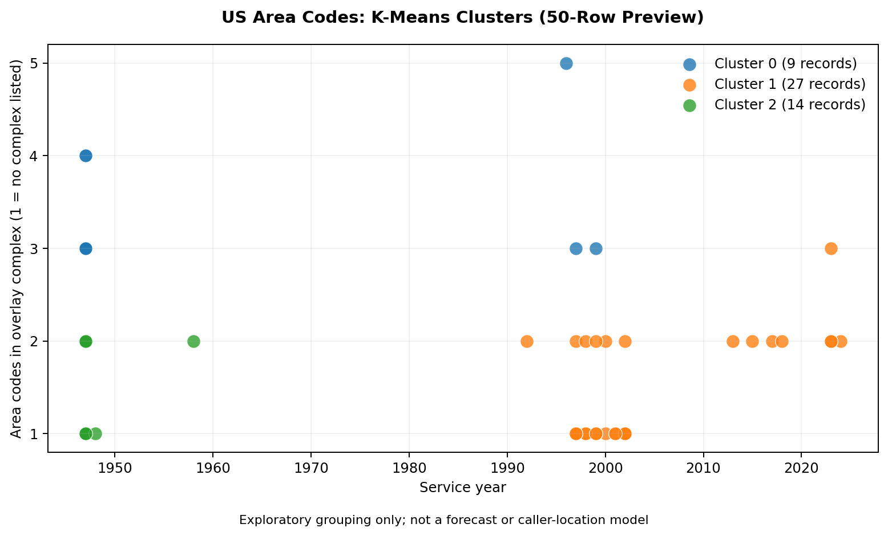

# US Area Codes — Machine Learning Demonstration

**Prepared by IT Altitudes Inc.**

This is a **reproducible educational K-Means clustering example** using the 50-row US Area Codes preview, sourced from NANPA reference data.

## Method

- Input: `us_area_codes_preview_50.csv` (50 records)
- Features: **service year** and **overlay-complex size** (number of slash-separated area codes in the listed complex; default 1 when no complex is supplied)
- Preprocessing: standardize both features with `StandardScaler`
- Algorithm: `KMeans(n_clusters=3, random_state=42, n_init=20)`
- Cluster sizes: {0: 9, 1: 27, 2: 14}
- Sample silhouette score: **0.573** (internal clustering separation, **not** accuracy)



## Reproduce

```bash
pip install pandas scikit-learn matplotlib
python run_ml_demo.py
```

The script regenerates `us_area_codes_ml_results.csv`. The chart and results in this folder were generated from the provided preview using the same K-Means configuration.

## Files

- `run_ml_demo.py`: executable Python demonstration
- `us_area_codes_preview_50.csv`: 50-row preview input
- `us_area_codes_ml_results.csv`: actual clustering assignments
- `us_area_codes_ml_chart.png`: visualization of the clusters
- `README_ML_DEMO.md`: explanation and limitations

## Important limitations

This is an **exploratory demonstration on a curated, nonrandom 50-row sample**, not a validated predictive model. Cluster numbers are arbitrary. The overlay-complex size is derived from a descriptive text field and may not represent all current overlays. No accuracy, future allocation prediction, caller geolocation, or regulatory reliability is claimed. Consult NANPA for current authoritative numbering information.

[GitHub preview](https://github.com/ITAltitudesDataset/us-area-codes-dataset-preview) · [Complete dataset information](https://italtitudes.gumroad.com/l/wehmwd)
